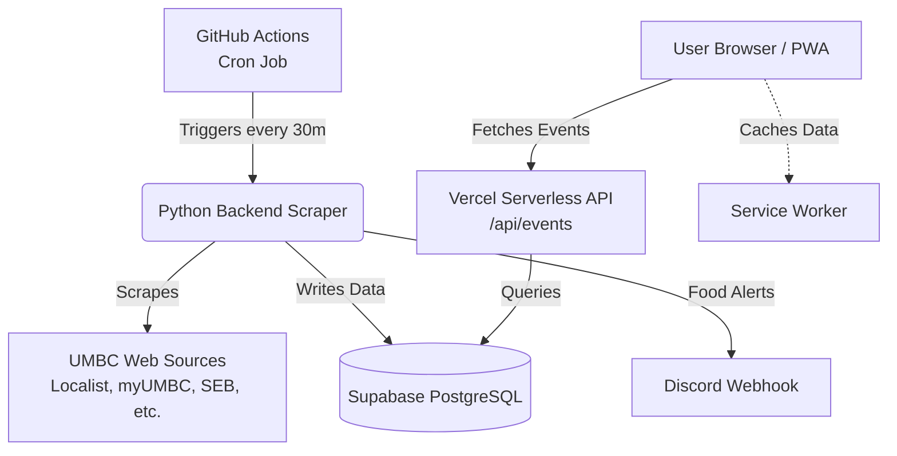
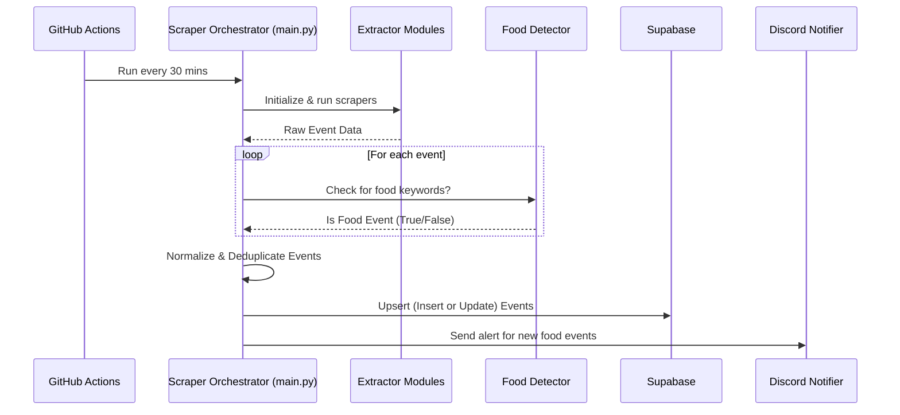

# UMBC Food Radar

Automated dashboard for UMBC: important dates, free food events, and campus activities.

## Features
- **Important Dates:** Registrar academic calendar + SBS billing deadlines
- **Free Food:** myUMBC, Retriever Essentials, Student Events Board (SEB), Dining
- **Campus Events:** myUMBC, umbc.edu/events, Campus Life (RAC), SEB, UMBC Tickets (athletics/arts), Student Affairs, Careers, Library, Athletics, Physics, Biology, Math/Stat, Dept Seminars, Grad School, Eventbrite, Meetup, Baltimore Magazine, Patch Calendar
- **Discord Alerts:** New food events posted to Discord when `DISCORD_WEBHOOK_URL` is configured
- **PWA:** Installable on mobile devices; works offline with cached data
- **Favorites, Share, Mini Calendar & Date Filter:** Save events to favorites, share via Web Share API, filter by date or time range
- **Auto-update:** Scheduled GitHub Actions runs every 30 minutes

*Note: Handshake requires student login and cannot be scraped. Career events appear via myUMBC groups and career center pages.*

---

## Architecture

### System Architecture Flow


### Data Scraping Pipeline


---

## Project Structure

```
├── frontend/                     # Client-side user interface (PWA)
│   ├── index.html                # Main application dashboard
│   ├── styles.css                # Primary styling & theme tokens
│   ├── script.js                 # Frontend interactions & calendar filtering
│   ├── event.html                # Event details & related events view
│   ├── event.css                 # Event details styling
│   ├── event.js                  # Event details logic & ICS generator
│   ├── manifest.json             # Web App Manifest for PWA installation
│   ├── sw.js                     # Service Worker for offline caching
│   └── icon.svg                  # Application icon
│
├── backend/                      # Python scraping engine & data processing
│   ├── scrapers/                 # 20+ specialized calendar & event scrapers
│   ├── utils/                    # Detection and notification helpers
│   │   ├── food_detector.py      # Keyword detection for free food
│   │   └── notifier.py           # Discord webhook notifications
│   ├── database/                 # Database migrations & schemas
│   │   └── supabase_migration.sql# Supabase SQL schema & RLS policies
│   ├── main.py                   # Scraper orchestrator & Supabase upsert
│   ├── verify_setup.py           # Smoke test script for setup verification
│   ├── requirements.txt          # Python dependencies
│   └── pyrightconfig.json        # Python typing configuration
│
├── api/                          # Serverless backend endpoints (Vercel)
│   └── events.js                 # Proxy endpoint for Supabase events
│
├── middleware.js                 # Edge middleware for rate limiting
├── vercel.json                   # Vercel deployment configuration & rewrites
├── .github/workflows/scraper.yml # GitHub Actions automated cron job
├── .env.example                  # Environment configuration template
└── README.md
```

---

## Setup & Running

### 1. Backend (Python Scrapers)

1. Create and activate a virtual environment:
   ```bash
   python -m venv venv
   .\venv\Scripts\Activate.ps1   # On Windows (PowerShell)
   # or: source venv/bin/activate # On macOS/Linux
   ```

2. Install dependencies:
   ```bash
   pip install -r backend/requirements.txt
   python -m playwright install chromium
   ```

3. Configure environment variables:
   - Copy `.env.example` to `.env`
   - Fill in `SUPABASE_URL` and `SUPABASE_KEY` (service role key for write access)
   - Optionally add `DISCORD_WEBHOOK_URL`

4. Run the scraper pipeline:
   ```bash
   cd backend
   python main.py
   ```

5. Verify setup:
   ```bash
   cd backend
   python verify_setup.py
   ```

### 2. Database (Supabase)

- Set up a project at [supabase.com](https://supabase.com).
- Run `backend/database/supabase_migration.sql` in the Supabase SQL Editor to initialize table columns, indexes, and Row-Level Security (RLS) policies.

### 3. Frontend & Deployment (Vercel)

- Configure environment variables in Vercel Project Settings:
  - `SUPABASE_URL`
  - `SUPABASE_ANON_KEY` (read-only key for client API requests)
- Vercel routes `/` and static assets to `/frontend` via `vercel.json` rewrites and serves `/api/events` through serverless functions.
- For local preview:
  ```bash
  npx vercel dev
  ```
  Or run any static server pointing to `frontend/`:
  ```bash
  python -m http.server 8000 -d frontend
  ```
