# UMBC Food Radar: UI and UX Redesign Spec

Version 1.0 (October 2026). Target: replace everything in `frontend/` with the design described here, plus the small backend and API changes the new UI depends on.

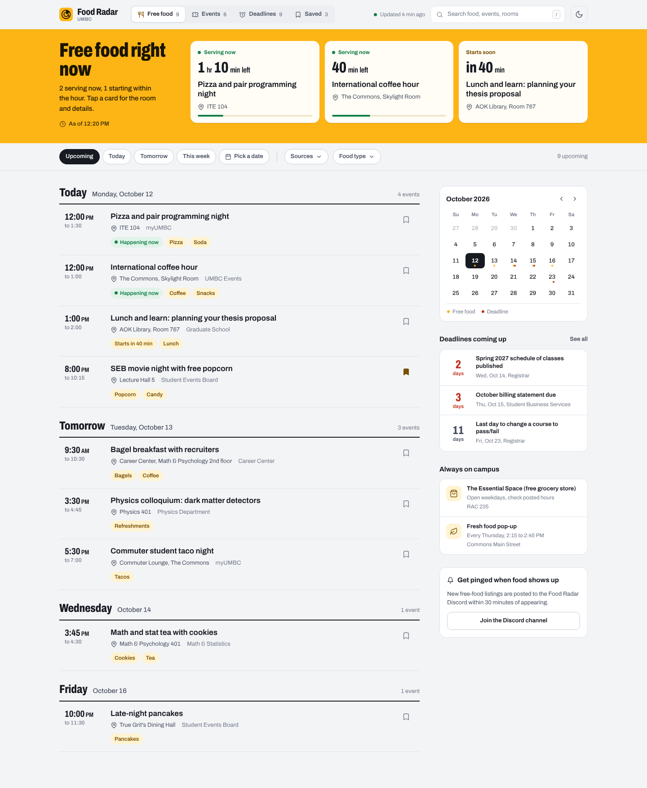

---

## 0. How to use this document (read this first if you are an agent)

- **Read order:** sections 1 to 4 for intent, section 5 for tokens, section 7 for components, section 9 for the data contract, section 14 for "done".
- **Visual source of truth:** the PNGs in `docs/ui-redesign/snapshots/`. If this text and a snapshot disagree, the snapshot wins for visuals and this text wins for behavior.
- **Working prototype:** `docs/ui-redesign/prototype/` is a static, dependency-free reference build of every screen. Open `index.html` in a browser. All state lives in the URL so each screen is linkable:
  - `?view=food|events|deadlines|saved`
  - `&theme=light|dark`
  - `&open=<eventId>` opens the detail drawer
  - `&popover=sources` opens the source filter
  - `&state=loading|error|offline|empty`
  - `&now=2026-10-12T12:20:00` freezes "now" (the prototype defaults to this so screenshots are stable)
- **What to reuse from the prototype:** `styles.css` (tokens and component CSS are production-quality and can be copied), the icon sprite in `index.html`, and the rendering structure in `app.js`.
- **What NOT to reuse:** `data.js` is fake sample data. The `now` freeze, the URL-param state hacks and the inline `onclick` handlers are prototype shortcuts. Production code must fetch `/api/events`, use real time, and use proper event listeners.
- **Do not** add a framework, a build step or a CSS library unless section 13 says so. The site is static on Vercel with a strict CSP.

---

## 1. Why the current UI fails

Observed on the live deployment and in `frontend/index.html`, `styles.css`, `script.js`, `event.html`:

- **The hero eats the screen.** The giant "UMBC Food Radar" title, radar rings and glowing orbs take about 45% of a 1080p viewport. The first real content starts below the fold on most laptops.
- **The main question is never answered.** A student opens this to learn "is there free food right now, and where?" Nothing on the page answers that. Every listing looks equally important whether it is happening now or in three weeks.
- **One lonely card on a huge canvas.** The Free Food tab defaults to a single "Ongoing" card in a 3-column grid, so the page looks broken and empty.
- **Inconsistent data rules.** `script.js` hides "Fresh Food Pop-Up" and "UMBC Dining Hall" from the list (`_BLOCKED_TITLES`), but the detail page shows them as "Related events". Users see items they can't find in the list.
- **Dates are free text.** The `date` field is whatever the scraper found ("Ongoing (Check RAC 235 Hours)", "10/14/26", "Every Thursday 2:15 PM - 2:45 PM"). Sorting, "upcoming", calendar export and grouping are all guesses built on regex. `+ Cal` exports a 1-hour event at midnight UTC for most listings.
- **Location is buried.** Where the food is, the single most useful fact, is hidden inside the description and never shown on the card.
- **Five controls with five looks.** Pills, a custom dropdown, a calendar button, a search bar and tabs all have different heights, radii, fonts and states.
- **Too many actions per card.** Heart, badge, Share, + Cal and an arrow on every card, so nothing stands out and the card is visually noisy.
- **Three typefaces and emoji as icons** (Outfit, Inter, plus a heavy display face in titles; 🍕📅🎉❤️🔍). Emoji render differently on every OS and can't be themed.
- **Low contrast.** Grey-on-near-black body text and metadata fall below WCAG AA in several places. There is no light theme.
- **Detail page is a dead end.** A full page navigation for a 1-sentence description, with 60% empty space and no location, no countdown and no "what else is nearby in time".
- **"Updated 2 min ago" is misleading.** It counts from when the browser fetched, not when the scraper last ran.

---

## 2. Goals and non-goals

**Goals**

- Answer "free food right now, and where" within 1 second of opening, on a phone, without scrolling.
- Make time the organizing principle: everything is grouped by day and sorted by start time.
- Show location on every listing.
- One coherent visual system, light and dark, AA contrast everywhere.
- Mobile-first: the majority of use is a phone between classes.
- Keep it a fast static PWA with no framework.

**Non-goals (for this version)**

- User accounts or server-side saved items (Saved stays on-device).
- Push notifications (Discord stays the alert channel).
- An interactive map with tiles (the CSP blocks third-party images; link out to the campus map instead).
- Changing which sites are scraped.

---

## 3. Users and their jobs

| Who | Job to be done | Where the UI serves it |
|---|---|---|
| Any undergrad between classes | "Is there free food in the next hour, and how far is it?" | Now band (section 7.4) |
| Student planning the week | "What free food and events are coming up this week?" | Timeline grouped by day (7.7) |
| Grad student | "Seminars and talks with refreshments" | Events view + "Free food only" toggle |
| Everyone | "Don't miss registration and billing deadlines" | Deadlines view with countdowns (7.12) |
| Students facing food insecurity | "Where can I get groceries any day?" | "Always on campus" panel (7.10) |

---

## 4. Information architecture

### 4.1 Sections

Four top-level sections. Same order everywhere (desktop header nav, mobile bottom nav):

1. **Free food** (default, `/`)
2. **Events** (`/?view=events`)
3. **Deadlines** (`/?view=deadlines`)
4. **Saved** (`/?view=saved`)

### 4.2 URL state (production)

All filter state is reflected in the query string with `history.replaceState`, so every view is shareable and the back button works.

| Param | Values | Default |
|---|---|---|
| `view` | `food`, `events`, `deadlines`, `saved` | `food` |
| `when` | `upcoming`, `today`, `tomorrow`, `week`, `YYYY-MM-DD` | `upcoming` |
| `src` | comma-separated source slugs | all |
| `food` | comma-separated food item slugs | all |
| `type` | event type slugs (Events view) | all |
| `freefood` | `1` (Events view toggle) | off |
| `kind` | `registration`, `billing`, `breaks` (Deadlines view) | all |
| `q` | search text | empty |
| `e` | event id; opens the detail drawer on top of the current view | none |

- Opening a listing pushes `?e=<id>` with `history.pushState` (back closes the drawer).
- **Legacy links:** keep `event.html?id=<id>` working. Replace `event.html` with a tiny page that redirects to `/?e=<id>`.

### 4.3 What lives where

```
Free food view
├── Now band ............. serving now / starting within 90 min / next up
├── Toolbar .............. When chips · Pick a date · Sources · Food type · result count
├── Main column
│   ├── (mobile only) next-deadline peek card
│   ├── Day groups ........ Today / Tomorrow / weekday name, rows sorted by start
│   └── (mobile only) Always on campus
└── Right rail (desktop) . Mini calendar · Deadlines coming up · Always on campus · Discord alerts

Events view ............... page title · toolbar (When · Type · Free food only) · day groups · rail (calendar, deadlines)
Deadlines view ............ page title · kind chips · groups (Next 7 days, Later in <month>, <Month>...) · rail (calendar, subscribe)
Saved view ................ page title · All/Food/Events/Deadlines chips · day groups + deadlines list · empty state
Detail drawer ............. any view, `?e=<id>`; right drawer on desktop, bottom sheet on mobile
```

---

## 5. Design system

### 5.1 Concept

"Campus bulletin board, sorted by the clock." Quiet, neutral, information-dense lists. **One** bold element: a solid UMBC-gold band at the top that shows what is serving right now. Gold is a fill color for that band and the active nav pill; it is not sprayed around as glows or gradients.

### 5.2 Color tokens

Defined on `:root` and overridden on `:root[data-theme="dark"]`. Copy from `prototype/styles.css`.

| Token | Light | Dark | Use |
|---|---|---|---|
| `--gold` | `#FDB515` | `#FDB515` | Now band fill, active mobile nav pill, primary-on-dark accents. Never for text on light backgrounds. |
| `--on-gold` | `#1A1500` | `#1A1500` | Text and icons on gold |
| `--gold-ink` | `#7A4F00` | `#FDB515` | Gold-family text (food tags, active icons) |
| `--gold-wash` | `#FFF3D1` | `rgba(253,181,21,.14)` | Food tag background |
| `--bg` | `#F3F4F6` | `#0E1117` | Page background |
| `--surface` | `#FFFFFF` | `#161A22` | Panels, drawer, row hover |
| `--surface-2` | `#ECEEF2` | `#1E232D` | Nav track, neutral tags, skeletons |
| `--ink` | `#171A21` | `#ECEEF2` | Primary text, day-group rules, selected chip fill |
| `--ink-2` | `#4A5161` | `#B4BAC6` | Secondary text |
| `--ink-3` | `#737A8A` | `#848B9A` | Tertiary text (source names, counts) |
| `--line` | `#E0E3E9` | `#262C37` | Row dividers, panel borders |
| `--line-strong` | `#C9CDD6` | `#353C49` | Chip borders |
| `--live` / `--live-wash` | `#12804A` / `#E2F3E9` | `#43D48E` / 13% | "Serving now", "Happening now" |
| `--urgent` / `--urgent-wash` | `#C2301B` / `#FBE7E3` | `#FF8370` / 13% | Deadlines within 3 days |
| `--soon` / `--soon-wash` | `#8A5A00` / `#FFF3D1` | `#FDB515` / 13% | Starts within 90 min, deadlines within 7 days |
| `--focus` | `#2F6BFF` | `#7AA2FF` | Focus ring |

Rules:

- Theme follows `prefers-color-scheme` on first visit; the header toggle overrides and is stored in `localStorage` (`foodradar_theme`). Wrap storage access in try/catch.
- The Now band stays gold in dark mode. Cards inside it stay light (`#FFFDF6`) in both themes.
- Every text/background pair must pass WCAG AA (4.5:1 body, 3:1 for text 18.66px bold and up).

### 5.3 Typography

- **One family: Archivo (variable, weight 100 to 900, width 62% to 125%)**, OFL licensed. Self-host `prototype/fonts/archivo-variable.woff2` (see 13.2 for the CSP change).
- Personality comes from the **width axis**: condensed (`font-stretch: 72% to 78%`, weight 750 to 850) for display headings, times and countdown numbers; normal width for everything else.
- `font-variant-numeric: tabular-nums` on `body` so times line up.

| Role | Size / line-height | Weight | Width | Example |
|---|---|---|---|---|
| Display (Now band h1, page titles) | 44px / 0.95 (34px mobile) | 850 | 72% | "Free food right now" |
| Countdown in Now card | 34px / 1 | 800 | 72% | "40 min left" |
| Drawer title | 34px / 1.05 (26px mobile) | 800 | 78% | |
| Day heading | 26px / 1.1 (20px mobile) | 800 | 75% | "Tomorrow" |
| Row time | 20px / 1.1 (17px mobile) | 750 | 75% | "12:00 PM" |
| Row title | 17px / 1.3 (15px mobile) | 650 | 100% | |
| Body | 15px / 1.5 | 400 to 500 | 100% | |
| Meta, chips | 13px | 500 to 600 | 100% | |
| Tags, small labels | 12px | 600 | 100% | |

Type rules:

- Sentence case everywhere. **No ALL-CAPS labels** (the current "ONGOING (CHECK RAC 235 HOURS)", "FREE GROCERIES", "RELATED EVENTS" all go).
- No emoji in UI chrome. Icons are SVG (5.6).
- Max line length about 65 characters for descriptions (`max-width: 62ch`).

### 5.4 Spacing, radius, elevation

- Spacing scale: 4, 6, 8, 10, 12, 14, 16, 20, 26, 32, 44 px.
- Page: `max-width: 1240px`; side gutter 32px desktop, 16px at 760px and below.
- Radii are tied to hierarchy, not one value for everything: `6px` small (skeleton, kbd), `10px` controls and buttons, `14px` panels and Now cards, `999px` chips and tags, `18px` top corners of the mobile sheet.
- Elevation: lists have **no shadows**; they are divided by 1px lines. Only floating layers (popover, drawer, toast) get `--shadow-pop`.

### 5.5 Motion

- One intentional moving element: the pulsing green dot on "Serving now" (2.4s loop).
- Response motion only: drawer slides in from the right (220ms, `cubic-bezier(.2,.8,.2,1)`), mobile sheet slides up, popovers fade+scale from 98%, Now card lifts 2px on hover.
- No staggered fade-up on list rows, no floating orbs, no radar rings.
- `prefers-reduced-motion: reduce` disables all animation and transitions.

### 5.6 Icons

Lucide-style 24x24 stroke icons, `stroke-width: 1.9`, drawn at 18px (15px small, 22px in bottom nav), `currentColor`. Inline SVG sprite (copy the `<symbol>` set from `prototype/index.html`): search, pin, bookmark, calendar, clock, share, external, x, moon, sun, food (utensils), ticket, alarm, chev-down/left/right, check, bell, bag, leaf, wifi-off, refresh, sliders.

### 5.7 Logo

32x32 rounded gold square with a two-ring radar and a sweep wedge (SVG in `prototype/index.html`). Wordmark "Food Radar" in Archivo 800 at 78% width with "UMBC" small beneath. Replace `frontend/icon.svg` and the manifest icons with this mark; add 192px and 512px PNG exports for the PWA manifest.

---

## 6. Layout and breakpoints

| Breakpoint | Layout |
|---|---|
| `>= 1100px` | Header with inline nav and search. Main column + 330px right rail, 44px gap. Now band: heading block 260px + 3 cards. |
| `761 to 1099px` | Same as above but the rail drops below the list (single column, rail sections become a 2-column grid). Now band: heading above cards, cards in a 3-up grid. |
| `<= 760px` | Mobile. Header shows logo, search icon, theme icon. Bottom tab bar. Now band cards become a horizontal snap scroller (78% width cards). Toolbar becomes a horizontally scrolling chip row. Rail hidden; its key content is moved inline (next-deadline peek above the list, Always on campus below it). Drawer becomes a bottom sheet (max 88vh). |

Sticky elements: header (top 0), toolbar (top = header height). Bottom nav fixed with `env(safe-area-inset-bottom)` padding. No horizontal page scroll at 320px width.

---

## 7. Components

Each component lists anatomy, states and behavior. CSS class names match the prototype.

### 7.1 App header (`.app-header`)

- Left: logo + wordmark (links to `/`).
- Center-left (desktop): primary nav (7.2).
- Right (desktop): freshness indicator, search field, theme toggle. Right (mobile): search icon button, theme toggle.
- Translucent `--bg` at 88% with `backdrop-filter: blur(10px)`, 1px bottom line. Height 64px desktop, 56px mobile.

**Freshness indicator:** green dot + "Updated 4 min ago". The time comes from `max(updated_at)` across the returned rows (when the scraper last wrote), not from when the browser fetched. If that is older than 75 minutes, the dot turns `--ink-3` and the text reads "Last updated 11:52 AM". While fetching: "Checking for new listings".

### 7.2 Primary nav (desktop) (`.primary-nav`)

Segmented control on a `--surface-2` track. Each item: icon + label + muted count. Active item: `--surface` fill, 1px `--line` ring, icon in `--gold-ink`, `aria-current="page"`. Counts: Free food = upcoming one-time food listings; Events = upcoming events; Deadlines = upcoming dates this term; Saved = saved items still upcoming.

### 7.3 Bottom nav (mobile) (`.bottom-nav`)

Four equal columns, icon above 11px label. Active item: icon sits in a gold pill (`--gold` fill, `--on-gold` icon), label in `--ink`. Inactive: `--ink-3`. Tap target at least 48px tall.

### 7.4 Now band (`.now-band`): the signature element

Full-bleed `--gold` band directly under the header, Free food view only.

**Left block:** h1 "Free food right now", a one-line summary, and "As of 12:20 PM" with a clock icon (desktop only).

Summary copy:
- `2 serving now, 1 starting within the hour. Tap a card for the room and details.`
- Only soon: `Nothing serving yet, 1 starting within the hour.`
- None: see quiet variant.

**Cards (up to 3), in this priority order:**

1. **Serving now** (`start <= now < end`), sorted by soonest end. Shows: green pulsing dot + "Serving now"; big condensed time left ("40 min left", "1 hr 10 min left"); title; location with pin; progress bar of elapsed time.
2. **Starts soon** (`0 < start - now <= 90 min`). Shows "Starts soon", big "in 40 min", title, location.
3. **Next up** (fills remaining slots with the next future listings). Translucent card variant (`.now-card.later`), "Next up, tomorrow" or "Next up, Wednesday", big start time.

Cards are links that open the detail drawer. Countdowns re-render every 30 seconds while the tab is visible; a card that ends is removed with a fade.

**Quiet variant** (`.now-band.quiet`, nothing serving or starting within 90 minutes): the band collapses to one row, about 64px tall: "Nothing serving right now" + "Next free food: Bagel breakfast, tomorrow 9:30 AM" + a "View" button.

**Loading:** the three cards render as translucent blocks and the summary reads "Checking campus listings".

Snapshots: `01`, `02`, `08`, `12`.

### 7.5 Toolbar and filters (`.toolbar`)

Sticky under the header, 60px tall (56px mobile), 1px bottom line. Left to right:

- **When chips** (Free food and Events): `Upcoming` (default), `Today`, `Tomorrow`, `This week`, then `Pick a date` (opens a month calendar popover; selected date replaces the chip label, for example "Wed, Oct 14", with an x to clear).
- Vertical divider.
- **Free food view:** `Sources` multi-select popover (7.6), `Food type` multi-select popover (Pizza, Snacks, Lunch, Coffee, Breakfast, Dessert, Groceries, Other), built from `food_items` in the data.
- **Events view:** `Type` multi-select popover (Talks, Workshops, Sports, Arts, Career, Social, Other) and a `Free food only` switch.
- **Deadlines view:** kind chips `All`, `Registration`, `Billing`, `Breaks and exams`.
- **Saved view:** chips `All`, `Food`, `Events`, `Deadlines`.
- Right-aligned result count ("9 upcoming"), hidden on mobile.

Chip states: default (`--surface`, `--line-strong` border, `--ink-2` text), hover (border `--ink-3`), pressed/selected (`--ink` fill, `--bg` text, `aria-pressed="true"`), menu chips with a value show the count ("Sources 3 of 6") and an `--ink` border.

Changing any filter updates the URL (4.2), re-renders the list, and scrolls to the top of the list only if the list's top is above the viewport.

### 7.6 Filter popover (`.popover`)

280px wide, `--surface`, radius 14px, `--shadow-pop`. Title ("Show food from"), checkbox rows with per-option counts, footer with `Clear` and `Show N results`. Changes apply live; the footer button just closes. Closes on Esc, outside click, or the footer button; focus returns to the trigger. On mobile, popovers open as a bottom sheet instead. Snapshot `04`.

### 7.7 Day group (`.day`)

- Heading row: condensed day name ("Today", "Tomorrow", then weekday names, then "Mon, Oct 26" beyond 6 days), the date in `--ink-2` ("Monday, October 12" for today and tomorrow, "October 14" after), and a right-aligned count ("4 events").
- 2px `--ink` rule under the heading. Rows below are separated by 1px `--line`.
- Listings with no parseable date go into a final group "Date to be announced".

### 7.8 Listing row (`.row`): replaces the old card

Three-column grid: `92px | 1fr | auto` (`64px` on mobile).

- **Time column:** start time big and condensed ("12:00" + small "PM"), end time underneath in 12px `--ink-3` ("to 1:30"; repeat AM/PM only if it differs from the start). All-day items show "All day".
- **Content column:** title (17px/650, max 2 lines with ellipsis); meta line with pin icon + location, then source name in `--ink-3`; tag row:
  - status tag first if relevant: `Happening now` (live, with dot), `Starts in 40 min` (soon), `Ended` (only when "include past" is on)
  - food tags (`.tag.food`), one per `food_items` entry, max 3 then "+2"
  - Events view: event type tag (neutral)
- **Action column:** one Save button (bookmark icon, 36px, filled `--gold-ink` when saved). Share and Add to calendar move into the detail drawer.
- Whole row is the click/tap target (opens drawer). It is a `<article>` containing an `<a href="/?e=id">` that covers the row, so middle-click and long-press work. Hover: `--surface` background. Selected (drawer open for it): `--surface` + 3px inset gold left edge.
- Past items (when shown) at 55% opacity.

### 7.9 Tags (`.tag`)

24px tall pills, 12px/600. Variants: neutral, `food`, `live`, `soon`, `urgent`. Never all caps.

### 7.10 Right rail panels (desktop)

All are `.panel` (surface, 1px line, 14px radius) with a 15px/700 heading above.

1. **Mini calendar:** current month, Sunday start, today as an `--ink` filled square, gold dot under days with free food, red dot under days with a deadline, legend underneath. Clicking a day sets `when=YYYY-MM-DD`. Prev/next month buttons.
2. **Deadlines coming up:** next 3 deadlines, each with a condensed countdown ("2 days", colored by urgency, 7.12), title, and "Wed, Oct 14, Registrar". "See all" links to Deadlines.
3. **Always on campus:** recurring and ongoing food resources (`kind` = `recurring` or `ongoing`, section 9): The Essential Space, Fresh food pop-up. Icon tile in gold wash, title, recurrence text, location. These no longer appear as fake dated rows in the timeline. (A recurring item's next occurrence may also appear in the timeline on its day if it has a real `start_at`.)
4. **Discord alerts card** (only if a public invite URL is configured in an env var): bell icon, "Get pinged when food shows up", one sentence, a "Join the Discord channel" button.

### 7.11 Detail drawer / bottom sheet (`.drawer`)

Desktop: 500px right drawer over a scrim. Mobile: bottom sheet with a grab handle, max 88vh, drag down or tap scrim to close. `role="dialog"`, `aria-modal="true"`, focus trapped, Esc closes, focus returns to the row.

Anatomy, top to bottom:

- Top bar: category tag (`Free food` / event type / `Deadline`) + source tag; close button.
- Title (condensed 800, 34px).
- Status strip: "Serving now, 40 min left" with progress (live), "Starts in 40 min" (soon), or "Due in 3 days" (deadlines, urgent colors).
- Facts list (`<dl>`):
  - **When:** "Today, October 12" / "12:00 PM to 1:30 PM". Recurring: recurrence text.
  - **Where:** location + "Open in UMBC campus map" link (see 10.7).
  - **Food:** food tags + the note "Picked up from the listing text. Supplies usually run out, so arrive early." This sets honest expectations about keyword detection.
- Description (full, not truncated), `max-width: 62ch`.
- "View the original listing on myUMBC" external link (opens new tab, `rel="noopener"`).
- "More free food today" (food listings only): up to 3 other food listings on the same day with time, title, location. Never shows items the list filters out.
- Sticky action bar: primary **Add to calendar** (menu: Google Calendar, Apple / Outlook (.ics)), **Save** / **Saved**, **Share** (icon-only on mobile).

Snapshots `03`, `07`, `10`.

### 7.12 Deadline row and countdown (`.dl-row`, `.countdown`)

- Grid `84px | 1fr | auto`. Left: condensed countdown number with "days" under it ("Today" when 0, "1 day" when 1).
- Urgency color: `<= 3 days` `--urgent`, `<= 7 days` `--soon`, otherwise `--ink-2`.
- Title, then full date ("Wednesday, October 14", or a range "Thu, Nov 26 to Sun, Nov 29") and source in `--ink-3`.
- Groups: "Next 7 days", "Later in October", then one group per month.
- Rail on this view: mini calendar + "Put every deadline in your calendar" card with a primary **Subscribe to deadlines** button linking to `webcal://<host>/api/deadlines.ics` (section 9.4).

Snapshots `06`, `11`.

### 7.13 Search

- Desktop: 300px field in the header with a `/` keyboard hint. `/` focuses it from anywhere, Esc clears and blurs.
- Mobile: search icon opens a full-width field that replaces the header row.
- Searches the current view across title, description, location, food items and source. Debounce 120ms. Matching text is wrapped in `<mark>` in titles.
- No results: "No listings match 'sushi'." + "Clear search" button.

### 7.14 Feedback: banners, toasts, skeletons, empty states

- **Offline banner** (`.banner.offline`): wifi-off icon, "You're offline. Showing listings saved at 11:52 AM." Data comes from the service worker cache.
- **Error banner** (`.banner.error`): "Couldn't refresh listings. Showing results from 11:52 AM." + "Try again" button. If there is no cached data: full empty state "Listings didn't load. Check your connection and try again." + "Try again".
- **Toasts** (bottom center, 4s): "Saved" with an "Undo" action; "Link copied"; "Added to calendar".
- **Skeletons:** Now band blocks, day heading bar and 3 row skeletons per group. Shimmer is disabled under reduced motion.
- **Empty states** are left aligned, icon tile + heading + one sentence + one action:
  - Saved: "Nothing saved yet" / "Tap the bookmark on any food listing, event or deadline to keep it here. Saved items stay on this device." / `Browse free food`
  - Filter too narrow: "No free food on Wednesday, October 14" / "Try another day or clear filters." / `Clear filters`

Snapshots `12` to `15`.

---

## 8. Screens (snapshot index)

All snapshots are in `docs/ui-redesign/snapshots/`. Desktop at 1440px wide, mobile at 390px (@2x).

| # | File | What it shows |
|---|---|---|
| 01 | `01-food-desktop-light.png` | Home, Free food view, full page, light theme |
| 02 | `02-food-desktop-dark.png` | Same in dark theme |
| 03 | `03-event-drawer-desktop.png` | Detail drawer for a listing that is serving now |
| 04 | `04-source-filter-desktop.png` | Sources popover open with 3 of 6 selected |
| 05 | `05-events-desktop.png` | Events view with type tags and Free food only switch |
| 06 | `06-deadlines-desktop.png` | Deadlines view with countdowns and subscribe card |
| 07 | `07-deadlines-desktop-dark.png` | Deadline detail drawer, dark theme |
| 08 | `08-mobile-food.png` | Mobile home, first screen |
| 09 | `09-mobile-food-scrolled.png` | Mobile home, full page including Always on campus |
| 10 | `10-mobile-detail-sheet.png` | Mobile detail bottom sheet |
| 11 | `11-mobile-deadlines-dark.png` | Mobile Deadlines, dark theme |
| 12 | `12-loading-desktop.png` | Loading skeletons |
| 13 | `13-error-desktop.png` | Refresh failed, showing cached data |
| 14 | `14-empty-saved-mobile.png` | Saved, empty state |
| 15 | `15-offline-mobile-dark.png` | Offline banner, dark theme |

### 8.1 Desktop home (Free food)


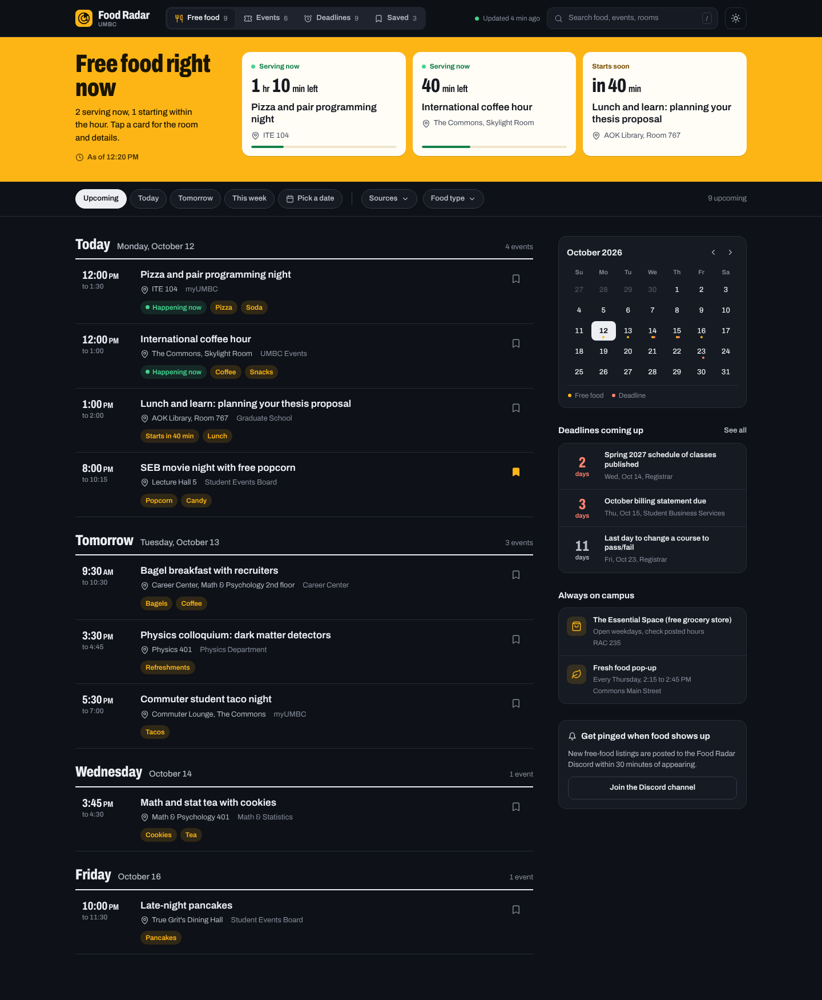

### 8.2 Detail drawer

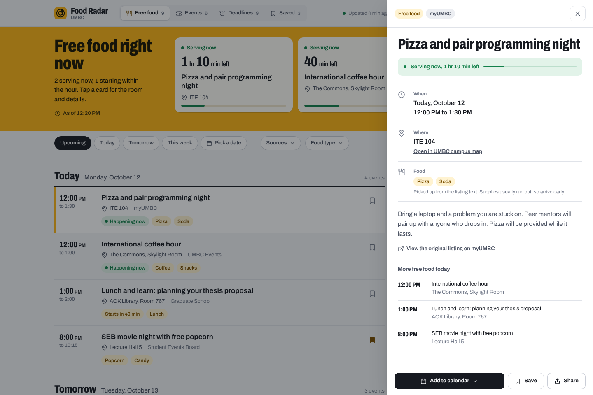

### 8.3 Source filter

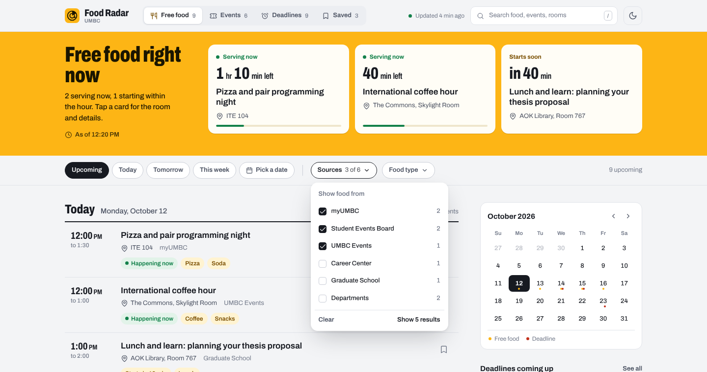

### 8.4 Events

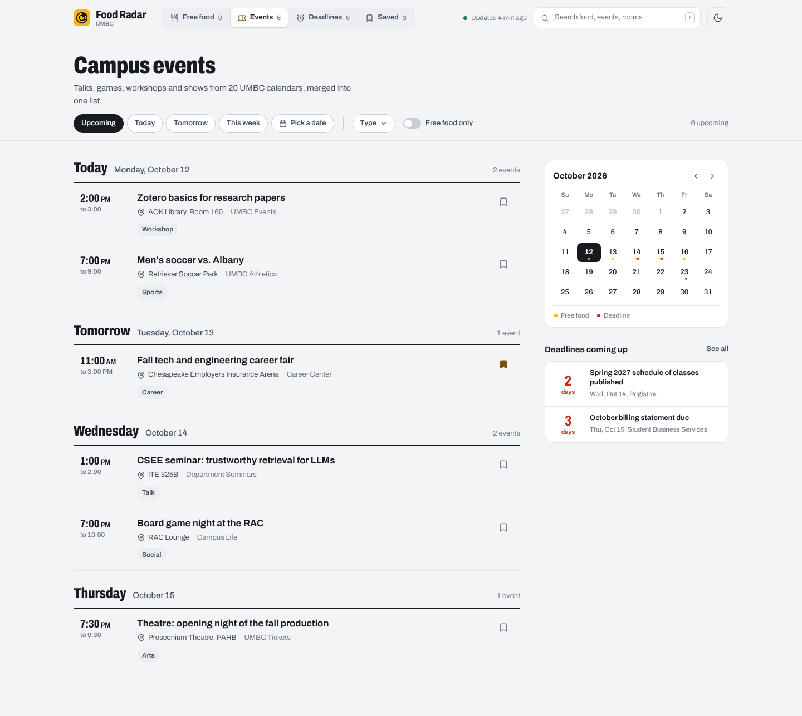

### 8.5 Deadlines

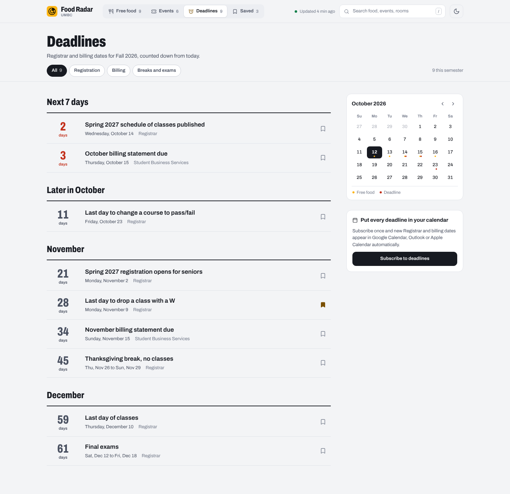

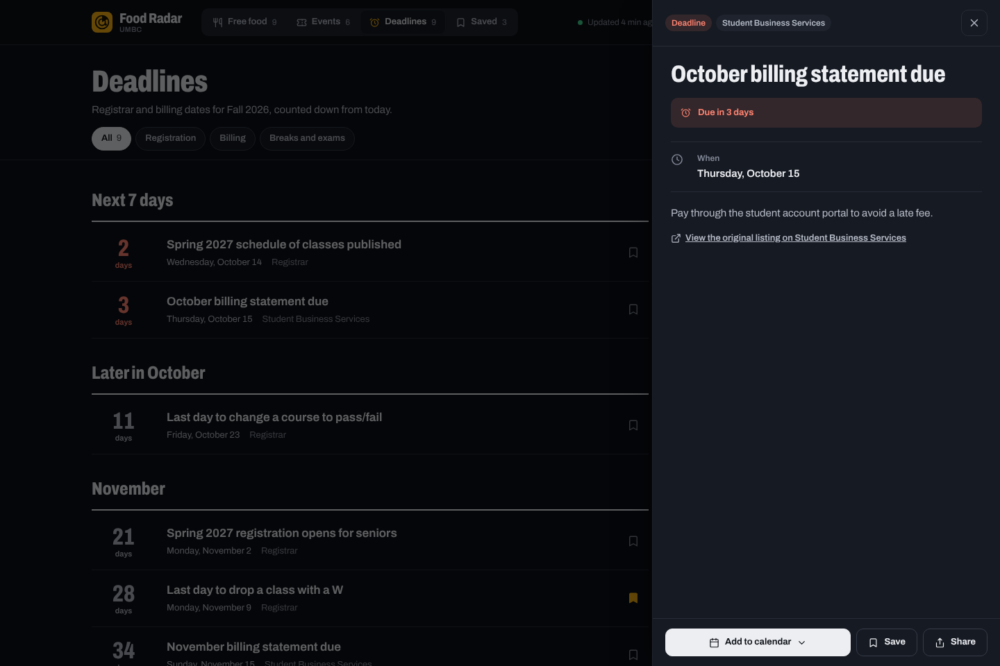

### 8.6 Mobile

<p>
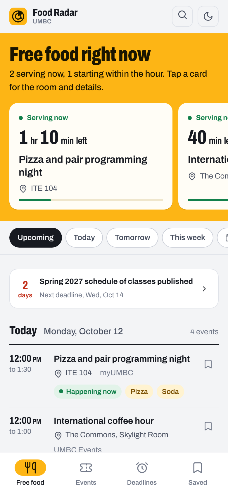
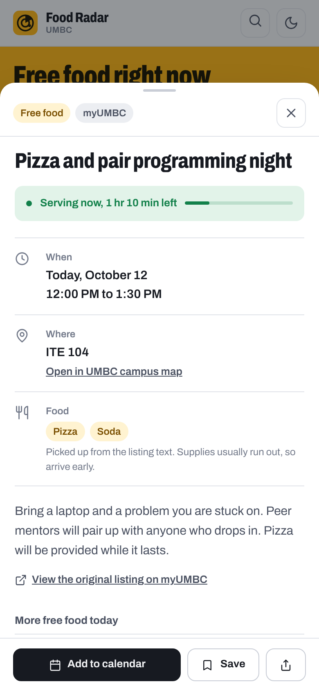
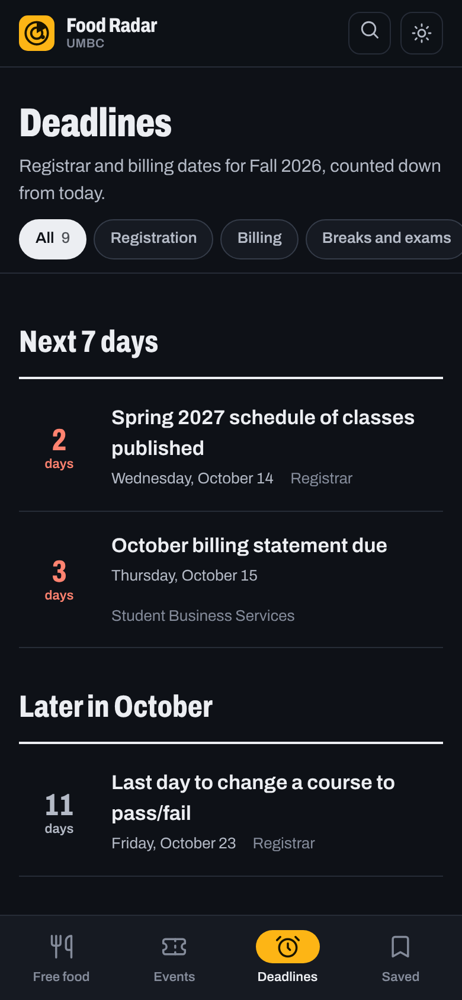
</p>

<p>
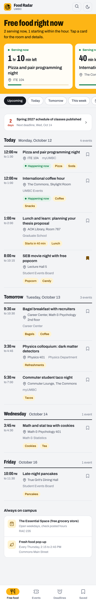
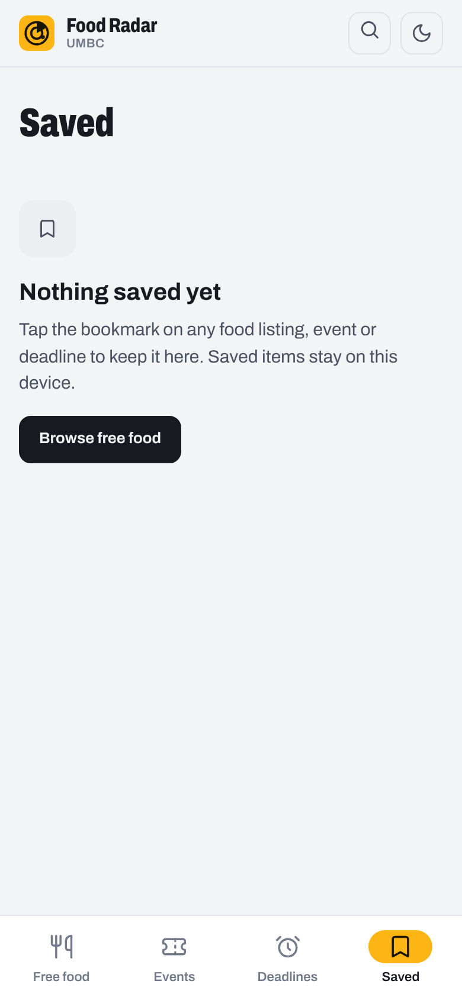
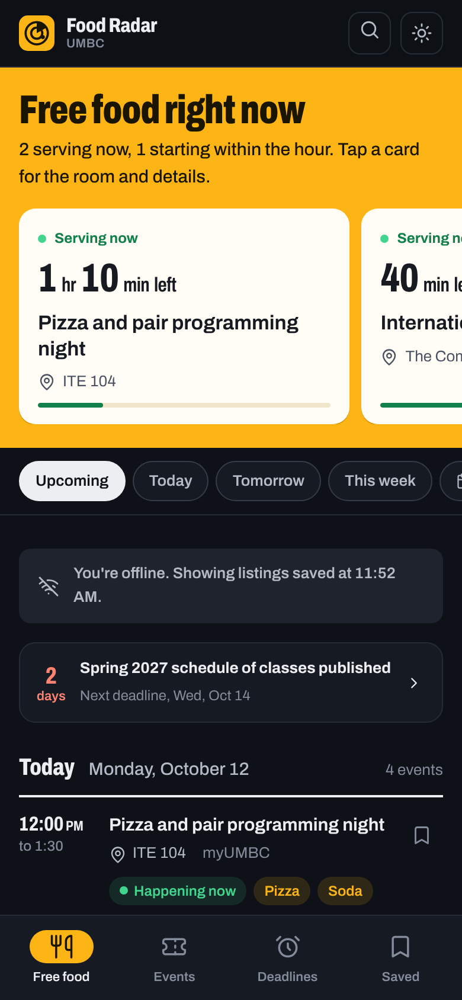
</p>

### 8.7 Loading and error

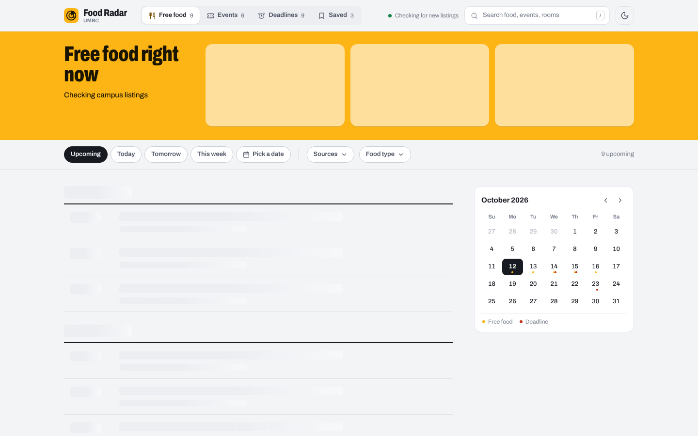

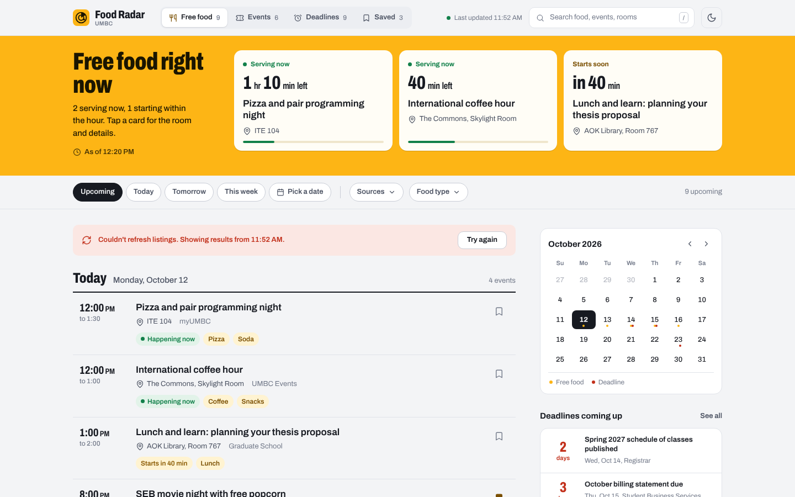

---

## 9. Data contract (backend changes the UI depends on)

The new UI needs structured time and place. Today the `events` table has: `id, title, date (free text), description, link, food_keyword, source, category, updated_at`.

### 9.1 New columns

```sql
-- backend/database/2026_10_ui_redesign.sql
ALTER TABLE events ADD COLUMN IF NOT EXISTS start_at        TIMESTAMPTZ;
ALTER TABLE events ADD COLUMN IF NOT EXISTS end_at          TIMESTAMPTZ;
ALTER TABLE events ADD COLUMN IF NOT EXISTS all_day         BOOLEAN DEFAULT FALSE;
ALTER TABLE events ADD COLUMN IF NOT EXISTS location        TEXT;
ALTER TABLE events ADD COLUMN IF NOT EXISTS food_items      TEXT[] DEFAULT '{}';
ALTER TABLE events ADD COLUMN IF NOT EXISTS kind            TEXT DEFAULT 'one_time'; -- one_time | recurring | ongoing
ALTER TABLE events ADD COLUMN IF NOT EXISTS recurrence_text TEXT;                    -- "Every Thursday, 2:15 to 2:45 PM"
ALTER TABLE events ADD COLUMN IF NOT EXISTS event_type      TEXT;                    -- talk | workshop | sports | arts | career | social | other
ALTER TABLE events ADD COLUMN IF NOT EXISTS deadline_kind   TEXT;                    -- registration | billing | breaks (important_date only)

CREATE INDEX IF NOT EXISTS idx_events_start_at ON events(start_at);
CREATE INDEX IF NOT EXISTS idx_events_category_start ON events(category, start_at);
```

Keep the old `date` and `food_keyword` columns populated for one release so the old frontend keeps working during rollout.

### 9.2 Scraper normalization (`backend/main.py`, `save_events`)

Add a `normalize(event)` step before upsert:

- **Times:** parse `date` (and any time text the scraper has) with `dateutil.parser` plus the existing regex patterns, interpreting naive times as `America/New_York`, and store UTC in `start_at` / `end_at`. If only a date is found, set `all_day = true`. If parsing fails, leave `start_at` null (UI puts it under "Date to be announced").
- **Ranges:** "2:15 PM - 2:45 PM", "Nov 26 - 29" must fill `end_at`.
- **Kind:** `ongoing` for text matching `ongoing|check .* hours|open weekdays`; `recurring` for `every (mon|tue|...)|weekly`; also compute the next occurrence into `start_at`/`end_at` for recurring items.
- **Location:** `base_scraper.fetch_localist_detail` already extracts `location` and then glues it onto the description. Return it as its own field instead and stop prefixing descriptions. For other scrapers, extract with a building-name regex (ITE, ENGR, Commons, RAC, AOK Library, Math & Psychology, Physics, Sherman Hall, PAHB, UC, Fine Arts, Sondheim, Public Policy, Lecture Hall N, True Grit's, Event Center / Chesapeake Employers Insurance Arena) and fall back to null.
- **Food items:** change `FoodDetector.get_matched_item` to return all distinct matches, mapped to display names (`pizza -> Pizza`, `refreshments -> Refreshments`, `free food -> Food`, etc.), stored in `food_items`.
- **Event type:** map from source first (Athletics -> sports, Tickets -> arts, Careers -> career, Department Seminars/Physics/Biology/MathStat -> talk, Library -> workshop), then keywords in the title.
- **Deadline kind:** SBS -> billing; Registrar titles with `break|exam|no classes` -> breaks; others -> registration.
- **Category fixes:** UMBC Dining hall hours are paid dining, not free food. Recategorize them out of `food_event` (or drop them). Remove the client-side `_BLOCKED_TITLES` hack; the Fresh Food Pop-Up becomes `kind = recurring` and shows in Always on campus.

### 9.3 API (`api/events.js`)

- Add optional query params: `category`, `from`, `to` (ISO), `fields`. Default stays "all rows" for backward compatibility.
- Select only needed columns: `id,title,description,link,source,category,start_at,end_at,all_day,location,food_items,kind,recurrence_text,event_type,deadline_kind,updated_at,date`.
- Order by `start_at.asc.nullslast`.
- Replace `no-store` with `Cache-Control: public, s-maxage=120, stale-while-revalidate=600`. Data only changes every 30 minutes; this makes the app much faster and lighter on Supabase.
- Return a top-level shape with metadata:

```json
{ "generated_at": "2026-10-12T16:20:00Z", "last_scraped_at": "2026-10-12T16:16:02Z", "events": [ ... ] }
```

(Frontend must also accept the old bare-array shape during rollout.)

### 9.4 New endpoint: `api/deadlines.ics`

Serverless function that returns an iCalendar feed of all `important_date` rows (`Content-Type: text/calendar`), all-day VEVENTs with stable `UID` = row id. Used by "Subscribe to deadlines".

### 9.5 Frontend fallback

If a row has no `start_at` (older rows during rollout), the frontend runs the existing `parseDateForSort` logic once at load to derive a best-guess start, and anything still unknown goes to "Date to be announced". Remove this fallback once all rows have been re-scraped.

---

## 10. Behavior rules

### 10.1 Time

- All display math in `America/New_York` using `Intl.DateTimeFormat` with `timeZone: 'America/New_York'`, regardless of the device time zone.
- "Upcoming" = `end_at > now` (or `start_at >= start of today` when there's no end).
- "This week" = now through end of Sunday.
- Status thresholds: live if `start <= now < end`; soon if starting within 90 minutes.
- Re-render time-dependent UI every 30 seconds when `document.visibilityState === 'visible'`.

### 10.2 Sorting and grouping

Sort by `start_at`, then `end_at`, then title. Group by local calendar day. Ongoing items never go into day groups.

### 10.3 Dedupe

Keep the existing `dedupeEvents` logic (Localist id, then title+date fingerprint), switching the fingerprint to `title + start_at`.

### 10.4 Refresh

- Fetch on load, on `visibilitychange` to visible if the last fetch is older than 5 minutes, and every 10 minutes while visible.
- Keep pull-to-refresh on mobile, but render it as a small spinner above the list, not a text label.
- Never blank the list while refreshing; swap data in place.

### 10.5 Saved

- Rename Favorites to Saved. Store in `localStorage` key `foodradar_saved` as `{ id: savedAtISO }`.
- One-time migration: read the old `umbc_food_radar_favorites` array, copy into the new key, then delete the old key.
- Past saved items are removed automatically 7 days after they end.
- Saving shows a toast "Saved" with Undo.

### 10.6 Add to calendar

- Google: `https://calendar.google.com/calendar/render?action=TEMPLATE&text=&dates=<start>/<end>&location=&details=` (UTC `YYYYMMDDTHHmmssZ`, or `YYYYMMDD/YYYYMMDD` for all-day).
- .ics: generate with real `DTSTART`/`DTEND` (UTC with `Z`), `LOCATION`, `UID`, `DTSTAMP`, escaped text, CRLF line endings. Download as `<slug>.ics`. If there's no `start_at`, hide the button instead of exporting a fake midnight event.

### 10.7 Campus map link

Link to UMBC's official campus map page (confirm the current URL before shipping) and, if the map supports a building query, pass the building name. Keep a small `BUILDINGS` lookup in `frontend/js/buildings.js` for that.

### 10.8 Share

`navigator.share({ title, text: "<title>, <day> <time> at <location>", url: "<origin>/?e=<id>" })`. Fallback: copy the link and show "Link copied". Share the Food Radar link (deep link into the drawer), not the source link.

### 10.9 Keyboard

`/` focus search · `Esc` close drawer/popover or clear search · `j`/`k` move between rows · `Enter` open row · `s` save focused row · `1` to `4` switch sections.

---

## 11. Accessibility

- WCAG 2.2 AA. Check every token pair in both themes.
- Semantic landmarks: `header`, `nav` (x2 with distinct `aria-label`), `main`, `aside`.
- Day groups are `section` with a heading; rows are `article` with a heading.
- The Now band summary is an `aria-live="polite"` region so screen readers hear changes; countdown numbers are not announced every 30s (update `aria-label` only when the minute changes).
- Visible focus ring on everything (`2px solid var(--focus)`, offset 2px).
- Drawer: focus trap, `aria-modal`, returns focus. Popovers: `aria-expanded` on trigger, Esc closes.
- Tap targets at least 44x44 on mobile.
- Color is never the only signal: live and soon states always carry text ("Serving now", "Starts in 40 min").
- Respect `prefers-reduced-motion` and `prefers-color-scheme`.

---

## 12. Copy guide

- Sentence case, plain verbs, no exclamation marks, no emoji.
- Name things the way students do: "Free food", "Deadlines", "Saved", "Room", not "food_event", "important_date", "Favorites".
- A button says what it does; the toast echoes it (`Save` -> "Saved", `Add to calendar` -> "Added to calendar").
- Errors explain what happened and what to do; they don't apologize.

| Where | String |
|---|---|
| Page title | `Food Radar: free food and deadlines at UMBC` |
| Now band h1 | `Free food right now` |
| Now band quiet | `Nothing serving right now` / `Next free food: {title}, {day} {time}` |
| Live card label | `Serving now` |
| Soon card label | `Starts soon` |
| Row status | `Happening now`, `Starts in {n} min` |
| Food note | `Picked up from the listing text. Supplies usually run out, so arrive early.` |
| Original link | `View the original listing on {source}` |
| Undated group | `Date to be announced` |
| Offline | `You're offline. Showing listings saved at {time}.` |
| Refresh error | `Couldn't refresh listings. Showing results from {time}.` |
| Search empty | `No listings match "{q}".` |
| Footer | `Listings come from 20+ UMBC calendars and refresh every 30 minutes. Always check the original listing before you go.` |

---

## 13. Implementation plan

### 13.1 Tech choices

- Plain HTML, CSS and ES modules, no framework and no build step (keeps the current Vercel static setup and CSP).
- Suggested structure:

```
frontend/
├── index.html            app shell, icon sprite
├── event.html            redirect: /?e=<id>
├── css/
│   ├── tokens.css        section 5 tokens, light + dark
│   ├── base.css          reset, type, focus, utilities
│   └── components.css    header, nav, now band, toolbar, rows, rail, drawer, states
├── js/
│   ├── main.js           boot, routing (URL state), refresh loop
│   ├── api.js            fetch + shape normalization + fallback date parsing
│   ├── time.js           America/New_York formatting, status, countdowns
│   ├── store.js          filters, saved (with migration), theme
│   ├── render/
│   │   ├── nowBand.js
│   │   ├── toolbar.js
│   │   ├── timeline.js
│   │   ├── rail.js
│   │   ├── drawer.js
│   │   └── deadlines.js
│   ├── calendar.js       Google link + .ics builder
│   └── buildings.js      building lookup for map links
├── fonts/archivo-variable.woff2
├── icons/ (icon.svg, icon-192.png, icon-512.png)
├── manifest.json
└── sw.js
```

- Render with template strings, but escape every data value (keep the existing `sanitize`). No `innerHTML` with unescaped scraper text.

### 13.2 Config changes

- `vercel.json` CSP: change `font-src https://fonts.gstatic.com` to `font-src 'self'` (fonts are self-hosted now) and drop the Google Fonts `style-src` entry.
- `manifest.json`: `theme_color` `#FDB515`, `background_color` `#F3F4F6`, new icons, `name` "UMBC Food Radar", `short_name` "Food Radar".
- `sw.js`: bump the cache version; precache the shell (HTML, CSS, JS, font, sprite); network-first with cache fallback for `/api/events`, and record the cache time so the offline banner can show it.

### 13.3 Milestones

1. **Data:** migration SQL, scraper normalization, API shape and caching, `deadlines.ics`. Re-run the scraper and confirm most rows have `start_at` and `location`.
2. **Shell and tokens:** new `index.html`, tokens, header, nav (desktop + mobile), theme toggle.
3. **Free food view:** Now band, toolbar, timeline, rail.
4. **Drawer:** detail, calendar export, share, save, deep links, legacy `event.html` redirect.
5. **Events, Deadlines, Saved views.**
6. **States and PWA:** skeletons, empty, error, offline, service worker.
7. **QA:** section 14 checklist on Chrome, Safari iOS, Firefox; Lighthouse.

---

## 14. Acceptance criteria

Visual

- [ ] Desktop 1440px and mobile 390px match the snapshots in layout, hierarchy, color and type (pixel-perfect is not required; structure and proportions are).
- [ ] Light and dark themes both work and follow the OS by default.
- [ ] No emoji, no ALL-CAPS labels, one typeface (Archivo), no glow orbs or radar rings.

Behavior

- [ ] On a phone, the Now band (or its quiet variant) is visible without scrolling.
- [ ] Every row shows time, title, location (when known) and source.
- [ ] Listings are grouped by day in `America/New_York` time and sorted by start.
- [ ] "Serving now" and "Starts in N min" are correct and update without reload.
- [ ] Ongoing and recurring resources appear in Always on campus, not as fake dated rows; nothing in "More free food today" is missing from the list.
- [ ] Filters, search and the open drawer are all reflected in the URL; reload and back/forward restore them.
- [ ] Old `event.html?id=...` links open the right drawer.
- [ ] Add to calendar exports the correct start/end time and location (verified in Google Calendar and Apple Calendar).
- [ ] Old favorites are migrated into Saved.
- [ ] Freshness shows the scraper's last run, not the fetch time.
- [ ] Works offline with cached data and shows the offline banner.

Quality

- [ ] Lighthouse mobile: Performance >= 90, Accessibility >= 95, Best Practices >= 95.
- [ ] No horizontal scroll at 320px.
- [ ] Full keyboard operation; visible focus everywhere; axe DevTools reports no serious issues.
- [ ] Total JS under 40 KB gzipped, CSS under 20 KB gzipped, one font file.

---

## 15. Regenerating the snapshots

The snapshots were rendered from the prototype with Playwright (Chromium). To regenerate after design tweaks:

```bash
pip install playwright
python -m playwright install chromium
python docs/ui-redesign/shoot.py
```

`shoot.py` lists every screen with its URL params and viewport, and writes PNGs into `docs/ui-redesign/snapshots/`.
